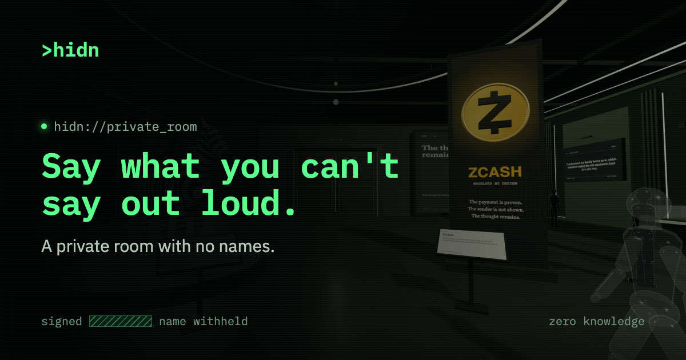

<p align="center">
  
</p>

<h1 align="center">HIDN</h1>

<p align="center"><b>Say what you can't say out loud.</b><br />A private room with no names, built on Zcash.</p>

<p align="center">
  <a href="https://hidnroom.com">Website</a> ·
  <a href="https://hidnroom.com/read">Read without joining</a> ·
  <a href="https://hidnroom.com/how-it-works">How it works</a> ·
  <a href="https://x.com/hidn_room">X (@hidn_room)</a>
</p>

---

## What is HIDN?

HIDN is an anonymous confession app. You can say the thing you've never told
anyone, reply to someone, or let people message you, and nobody (not other
people, and not HIDN) can tell it was you.

There is **no account**. No email, no phone number, no username, no password.
When you join, your browser makes a private **key** that only you keep. Every
post, reply and like then carries a **zero-knowledge proof**: maths that shows
"a real member wrote this" without revealing *which* member.

That is the same kind of proof Zcash uses to keep payments private, applied to
words.

> **Want your network address hidden too?** Open HIDN in
> [Tor Browser](https://www.torproject.org/) at the **Standard** security level.
> HIDN hides *who* wrote it; Tor hides *where* you're connecting from.

## Try it

| | |
| --- | --- |
| **Website** | [hidnroom.com](https://hidnroom.com) |
| **Read first, no key needed** | [hidnroom.com/read](https://hidnroom.com/read) |
| **Go anonymous: mask your profile picture** | [hidnroom.com/mask](https://hidnroom.com/mask) |
| **How it works, in plain words** | [hidnroom.com/how-it-works](https://hidnroom.com/how-it-works) |
| **Follow along** | [x.com/hidn_room](https://x.com/hidn_room) |

## What you can do

- **Confess, reply and like with no name.** Posts and replies are up to 500
  characters. Links aren't allowed anywhere, so people say it in words.
- **Pick a room.** Seven topic rooms (plus a seasonal one), each with its own
  share link, so you can post a room to X or WhatsApp instead of the whole app.
- **Read the feed.** Every room mixed together, or one room at a time,
  ordered by latest, random or most felt.
- **Get anonymous messages, end-to-end encrypted.** Create one private link and
  share it anywhere. Anyone can write to you through it, with no account. Each
  message is encrypted in the sender's browser and only your device can read
  it, not even HIDN. Up to 120 messages a day per link.
- **Tip in shielded ZEC.** Turn on tips for a post or your private link and
  readers can pay you from their own Zcash wallet, straight to yours. HIDN never
  holds the money or a spending key.
- **Share posts as images.** Save or share any post as a card in three sizes
  (post 4:5, story 9:16, wide 16:9) and choose which replies go on it.
- **Mask your profile picture.** Twelve masks that wipe your whole face, not
  just your eyes. The photo is processed on your device and is never uploaded
  or stored.
- **Walk the lobby.** A 3D museum where real posts hang on the walls, with
  rooms to explore and a library of Zcash lessons.
- **Get notified quietly.** A bell tells you when someone likes or replies to
  your post, without linking your posts to each other.

## Rooms

| Room | What it's for | Share link |
| --- | --- | --- |
| General | Everything people are saying | [/r/general](https://hidnroom.com/r/general) |
| Things I've never told anyone | Say it here first | [/r/never-told-anyone](https://hidnroom.com/r/never-told-anyone) |
| Talk about your ex | Women and men spill | [/r/talk-about-your-ex](https://hidnroom.com/r/talk-about-your-ex) |
| Ragebait me | Say the take that starts a fight | [/r/ragebait-me](https://hidnroom.com/r/ragebait-me) |
| The wildest thing you've done | No names. No judgment. Just tell it | [/r/wildest-thing](https://hidnroom.com/r/wildest-thing) |
| Student secrets | School, uni, everything in between | [/r/student-secrets](https://hidnroom.com/r/student-secrets) |
| Crypto confessions | Wins, losses, things you'd never tweet | [/r/crypto-confessions](https://hidnroom.com/r/crypto-confessions) |
| Things that haunt me | Halloween only. Open until 1 November, then read-only | [/r/haunted](https://hidnroom.com/r/haunted) |

The list lives in [`apps/web/src/product/room-links.ts`](apps/web/src/product/room-links.ts)
and is shared by the website and the server, including each room's opening and
closing times.

## How the anonymity works

In short: **HIDN can check that you're a member, but never which member.**

1. **You get a key.** Your browser creates a random 31-byte secret. Its
   readable form (`HIDN-ANON-…`) is your key and the only way back in, so save
   it (the site helps you put it in your password manager).
2. **Only a fingerprint is shared.** The browser sends HIDN a Poseidon
   *commitment* to the secret, never the secret itself. Commitments join a
   20-level Merkle tree with room for 1,048,576 members.
3. **Every action carries a proof.** When you post, reply, like or report, your
   browser makes a Groth16 proof that your commitment is somewhere in that tree.
   Your secret, your position in the tree and the Merkle path never leave the
   browser.
4. **Each proof works once, for one message.** `Poseidon(secret, scope)` makes a
   one-use *nullifier*, so a proof can't be replayed. `Poseidon(nullifier, message)`
   binds the proof to that exact post, so it can't be reused for different words.
5. **One like per post, without tracking.** A like's scope is fixed to its post,
   so a second like on the same post is refused, while likes on different posts
   can't be linked to each other.
6. **Nothing ties your posts together.** Posts, replies and likes store no
   member name. Each gets its own one-off notification key, kept in your
   browser. The `ANON-…` name you see is cosmetic and changes every visit.
7. **Private links stay unlinked.** Your inbox opens with a key derived from
   your secret; the server keeps only its hash, not which member owns the link.
8. **Link messages are end-to-end encrypted.** Each link has its own key pair.
   Senders seal every message to the link's public key with a fresh one-time
   key (ECDH P-256, HKDF-SHA-256, AES-256-GCM), padded to a fixed size so its
   length gives nothing away. The private half is stored only after being
   wrapped with a key derived from your secret, so any device with your HIDN
   key can open your inbox and the server never can. It all runs on the
   browser's built-in WebCrypto, with no extra library.
9. **Notifications are end-to-end encrypted too.** Your browser makes a key
   pair for each of your one-off notification keys and registers only the
   public half. When someone likes or replies, the server seals what happened
   and which post it was to that key, so stored notifications are fixed-size
   ciphertext that only your browser can open. Likes and replies themselves
   are public on the post, and neither records who sent them.

### Where to look in the code

| What | Where |
| --- | --- |
| Membership circuit | [`packages/anonymous-zk/circuits/hidn_membership.circom`](packages/anonymous-zk/circuits/hidn_membership.circom) |
| Protocol and Merkle helpers | [`protocol.ts`](packages/anonymous-zk/src/protocol.ts), [`merkle.ts`](packages/anonymous-zk/src/merkle.ts) |
| Browser prover (in a Web Worker) | [`prover.ts`](packages/anonymous-zk/src/prover.ts), [`anonymous-proof-worker.ts`](apps/web/src/anonymous-proof-worker.ts) |
| Verifier | [`verifier.ts`](packages/anonymous-zk/src/verifier.ts) |
| Server checks, replay protection, rate limits, link blocking | [`apps/web/src/worker.ts`](apps/web/src/worker.ts) |
| End-to-end encrypted link messages and notifications | [`apps/web/src/product/link-e2e.ts`](apps/web/src/product/link-e2e.ts) |
| Public proving files | [`public/anonymous-zk/v2/`](public/anonymous-zk/v2/) |

### Going further with Tor

HIDN proves you're a member without saying which one, and stores nothing that
ties your posts together. The one thing a website can't hide by itself is the
network address you connect from. **Tor Browser closes that gap:** use it at the
**Standard** security level (the Safer and Safest levels turn off the
WebAssembly that HIDN uses to make proofs in your browser).

### What's next

| Now | Next |
| --- | --- |
| Membership proofs use a public Powers of Tau setup plus one HIDN contribution ([details](docs/HIDN-ANONYMOUS-ZK-MILESTONE.md)). | **PLONK**, which needs no HIDN-run ceremony, then **Halo 2**, Zcash's own proof system, which needs no trusted setup at all. |
| Tor Browser hides your network address. | A built-in relay option for people who don't use Tor. |

The words you post are, by design, visible to readers. What stays hidden is
**who** wrote them.

## What HIDN measures (and doesn't)

HIDN has a private metrics page for its team, built to keep the same promise:

- **Counts, never people.** Totals like keys created, posts, replies, likes and
  private-link messages, plus posts per room. Because posts are zero-knowledge,
  HIDN can't tell members apart, so there are no per-person histories,
  daily-active-user counts or retention numbers, by design.
- **Page views as daily tallies.** The server adds one to a daily total of page,
  referring site and country. No IP addresses, cookies, device details or IDs
  are stored, bots and link previews aren't counted, private link and post
  addresses are never recorded, and referring sites are reduced to their main
  domain.
- **No third-party trackers.** No Google Analytics, pixels or tracking scripts.
  Fonts are self-hosted.

## Moderation and admin

Anyone can report a post, and reported posts can be hidden. The admin area
(reports, metrics, team roles and an audit log) is protected twice: Cloudflare
Access sits in front of it, and the server checks every request's signed Access
identity and the person's HIDN role (super admin, moderator or reviewer) before
doing anything. Admin actions are only accepted from HIDN's own pages, and every
change is written to the audit log. Setup details are kept out of this
repository; see [`docs/HIDN-ADMIN-ACCESS.md`](docs/HIDN-ADMIN-ACCESS.md).

## Built with

- **Frontend:** Vite + TypeScript, no framework. IBM Plex Sans and Mono,
  self-hosted. A Three.js museum for the lobby.
- **Server:** a Cloudflare Worker that serves the site and the API.
- **Database:** Cloudflare D1 (`hidn-room`), migrations in [`migrations/`](migrations/).
- **Zero knowledge:** Circom + Groth16 (snarkjs), Poseidon hashing, proofs made
  in the browser.
- **Payments:** shielded Zcash, wallet to wallet; HIDN only shows the payment
  request.

## Run it locally

You need Node.js (with npm workspaces).

```bash
npm install
npm run dev
```

Before opening a pull request:

```bash
npm run typecheck
npm run build
```

The Vite dev server sends API calls to the Worker origin set in
`apps/web/vite.config.ts`; set `HIDN_ROOM_API_ORIGIN` to point somewhere else.
To run the Worker itself locally with a local database:

```bash
npx wrangler d1 migrations apply hidn-room --local
npx wrangler dev --local
```

The Worker reads these settings (keep real values out of Git):

```text
ANONYMOUS_ZK_ENABLED=true
ANONYMOUS_ZK_VERIFICATION_KEY_V2=<JSON verification key, protocol v2>
ANONYMOUS_ZK_VERIFICATION_KEY=<JSON verification key, v1, for older pages>
```

### Test the proof system

```bash
npm --workspace @hidn/anonymous-zk run build:circuit
npm --workspace @hidn/anonymous-zk run test:protocol
npm --workspace @hidn/anonymous-zk run test:proof
```

`test:proof` makes a real Groth16 proof and checks that a tampered message or
scope is rejected. It needs a proving key in `packages/anonymous-zk/build/`
(generated files there are ignored by Git).

## Repository layout

```text
apps/web/                The website and the Cloudflare Worker (API + pages)
packages/anonymous-zk/   Membership circuit, browser prover, verifier
packages/ui/             Shared design tokens, typography and components
packages/shared/         Shared types and wording
packages/privacy/        Privacy protocol boundary
packages/zcash/          Zcash integration boundary
migrations/              D1 database migrations
public/                  Brand assets, link-preview images, fonts, proving files
docs/                    Product, privacy, architecture, brand and protocol notes
```

## Docs

- [Product](docs/HIDN-PRODUCT.md) · [Privacy](docs/HIDN-PRIVACY.md) ·
  [Architecture](docs/HIDN-ARCHITECTURE.md) · [Brand](docs/HIDN-BRAND.md) ·
  [Design system](docs/HIDN-DESIGN-SYSTEM.md)
- [Anonymous ZK protocol](docs/HIDN-ANONYMOUS-ZK-MILESTONE.md) ·
  [Zcash verification (planned)](docs/HIDN-MAINNET-ZCASH-VERIFICATION-MILESTONE.md) ·
  [Admin access](docs/HIDN-ADMIN-ACCESS.md)

---

<p align="center">
  <a href="https://hidnroom.com">hidnroom.com</a> ·
  <a href="https://x.com/hidn_room">@hidn_room on X</a><br />
  <sub>&gt;hidn · show the thought, hide the person.</sub>
</p>
